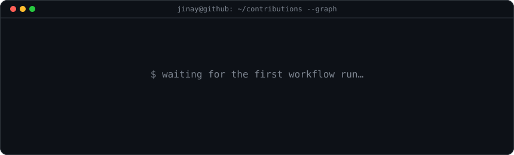

<!-- glitch ASCII wordmark: python scripts/make_wordmark_glitch_svg.py "Jinay Ajmera" -->

 
 

<!-- animated contribution graph: real data, boxes reveal cell by cell
     (regenerated daily by .github/workflows/update-profile-art.yml) -->

<h3><code>jinay@github ~ $ ./contributions.sh</code></h3>

 
 

<!-- streak / numbers card (same daily workflow: python scripts/render_stats_svg.py) -->

<h3><code>jinay@github ~ $ ./stats.sh</code></h3>

 
 

<h3><code>jinay@github ~ $ ./links.sh</code></h3>

<b>Aspiring Full-Stack Web Developer · CSE Student @ VIT · Building real-life, AI-integrated projects</b>

 
 

<!-- skills card: edit scripts/render_skills_svg.py then run it to regenerate -->

<h3><code>jinay@github ~ $ ./skills.sh --list</code></h3>

 
 

<h3><code>jinay@github ~ $ ./projects.sh</code></h3>

| Project | What it does | Stack |
| --- | --- | --- |
| [**CouchBeam**](https://github.com/jinayajmera/CouchBeam) | Real-time watch party. A server-authoritative clock plus a client drift engine keep every viewer on the same frame; time-locked chat, reaction heatmap and a crowd-sourced highlight reel. | TypeScript · React · WebSockets · Zod · Vitest · Docker |
| [**RoboSurge**](https://github.com/jinayajmera/VulneraSanenetur) | Dual-arm robotic surgery demo. Natural-language command → camera perception → LLM plan → hard safety validator → execution on an ESP32 over serial. | Python · YOLOv8 · OpenCV · Groq · FastAPI · React · Three.js · Express |
| [**E.V.**](https://github.com/jinayajmera/E.V.) | Online voting system. Verified voters, ACID vote casting through stored procedures, triggers, an audit trail and layered web security. | Python · Flask · MySQL · bcrypt · Docker |
| [**SDN Traffic Engineering**](https://github.com/jinayajmera/SDN-based_traffic_engineering) | Group case study. A deep-RL (PPO) agent learns link weights for SDN routing and is benchmarked against OSPF, ECMP and an LP-optimal bound, with a Streamlit dashboard. | Python · PyTorch · Stable-Baselines3 · Gymnasium · Streamlit |
| [**CyberCrimeReport**](https://github.com/jinayajmera/CyberCrimeReport) | Source-traceable analysis of registered cybercrime across Indian States/UTs (NCRB, 2018–2023): population-adjusted rates, hypothesis tests and a 2024 forecast. | Python · Pandas · Statistics |

 

